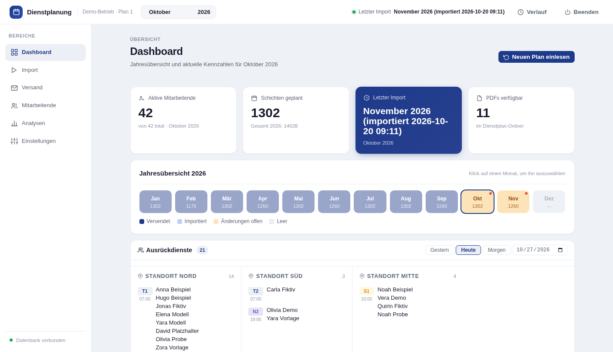
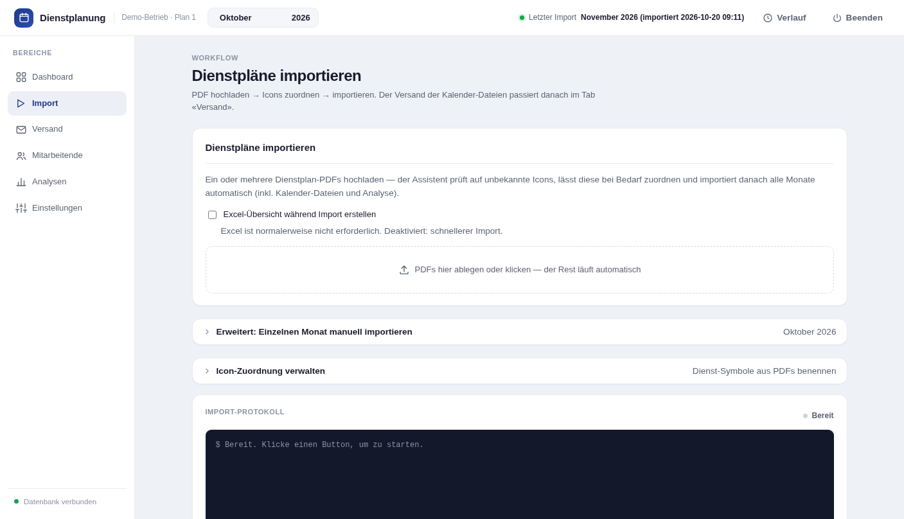
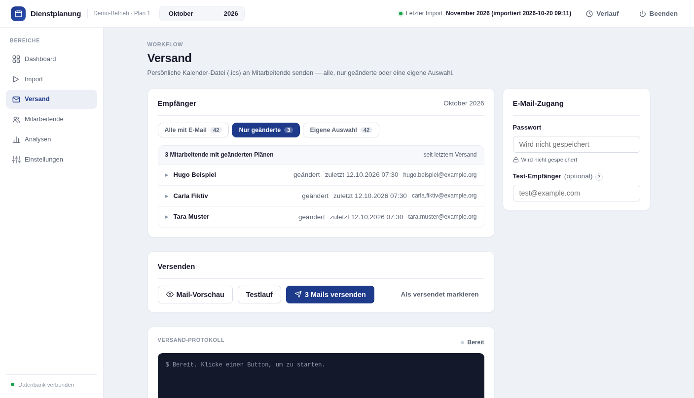
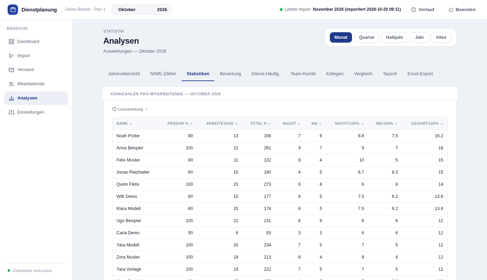

# Dienstplanung

Macht aus einem POLYPOINT/PEP-Dienstplan-PDF persönliche Kalender für jede Mitarbeiterin und jeden Mitarbeiter.

Der Monatsplan wird als PDF eingelesen — Dienste werden anhand ihrer Icons erkannt — und alle Schichten landen in einer SQLite-Datenbank. Von dort führen zwei Wege in den Kalender: als **`.ics`-Datei per E-Mail**, die jede Person in Outlook, iPhone oder Android importiert, wobei beim Versand nur die tatsächlich geänderten Pläne hervorgehoben werden; oder als **Webcal-Abo** — ein persönlicher Link, den man einmal im Kalender-Programm einträgt und der sich danach von selbst aktualisiert, sobald sich der Dienstplan ändert. Jeder Termin trägt Dienstzeit, Standort und die Namen der Kolleginnen und Kollegen, die an dem Tag mit eingeteilt sind.

Ein lokales Web-Interface deckt den ganzen Ablauf ab: PDF importieren, Kalender erzeugen und versenden, Stammdaten pflegen und den Plan auswerten — nach Nacht- und Wochenenddiensten, nach Besetzung pro Standort oder nach der Verteilung der Belastung, normiert aufs Pensum.

Läuft **vollständig lokal** — Internetverbindung nur optional für den Webcal-Feed via Cloudflare Tunnel.

---

## Screenshots

| Dashboard | Import |
|---|---|
|  |  |

| Versand | Analysen |
|---|---|
|  |  |

---

## Inhaltsverzeichnis

- [Projektstruktur](#projektstruktur)
- [Installation](#installation)
- [Einmalige Einrichtung](#einmalige-einrichtung)
- [Web-Interface](#web-interface)
- [Monatlicher Workflow](#monatlicher-workflow)
- [E-Mail-Versand](#e-mail-versand)
- [ICS-Kalender](#ics-kalender)
- [Webcal-Abonnement](#webcal-abonnement)
- [Analysen](#analysen)
- [Mitarbeiter-Stammdaten](#mitarbeiter-stammdaten)
- [Einstellungen](#einstellungen)
- [Deployment (Server / Docker)](#deployment-server--docker)
- [Cloudflare Tunnel (externer Webcal-Zugriff)](#cloudflare-tunnel-externer-webcal-zugriff)
- [DB-Migration nach Updates](#db-migration-nach-updates)
- [Direkte SQL-Abfragen](#direkte-sql-abfragen)
- [Unterstützen](#unterstützen)
- [Lizenz](#lizenz)

---

## Projektstruktur

```
Dienstplanung/
├── app.py                       ← Flask-Instanz (sys.path, secret_key)
├── gui.py                       ← Server-Einstiegspunkt (Blueprints registrieren)
├── config.py                    ← Dienstzeiten, E-Mail-SMTP, Pfade (nicht in Git)
├── config.py.example            ← Vorlage für config.py
├── settings.py                  ← Benutzereinstellungen lesen/schreiben
├── tasks.py                     ← Hintergrund-Tasks (Subprocess + SSE)
├── start.sh                     ← venv einrichten und GUI starten
├── deploy.sh                    ← Server-Deployment via Git + Docker
│
├── routes/                      ← Flask API-Blueprints
│   ├── main.py                  ← Startseite, PDF-Liste, SSE-Stream, SERVER_CONTEXT
│   ├── monatslauf.py            ← PDF-Import, Excel/ICS-Export
│   ├── mail.py                  ← E-Mail-Versand, Diff-Erkennung
│   ├── mitarbeiter.py           ← MA-Stammdaten, E-Mail-Adressen, Webcal-Token
│   ├── webcal.py                ← Geschützte ICS-Feeds (Token + Rate-Limit)
│   ├── analyse_api.py           ← 6 Analyse-Endpunkte (JSON)
│   ├── werkzeuge.py             ← Backup, Icon-Mapping, PDF-Upload, Downloads
│   ├── data.py                  ← Dashboard-KPIs, Monatskalender
│   └── einstellungen.py         ← Einstellungen, Dienstzeiten, Neustart
│
├── lib/                         ← Kernbibliotheken (CLI + Server)
│   ├── db_setup.py              ← DB-Schema erstellen, Dienst-Typen seeden
│   ├── db_import.py             ← PDF → Datenbank importieren
│   ├── db_export_excel.py       ← DB → Excel-Übersicht
│   ├── db_export_ics.py         ← DB → ICS-Kalender mit Kollegen-Info
│   ├── db_analyse.py            ← Auswertungen + Excel-Export
│   ├── db_mitarbeiter.py        ← MA-Stammdaten (CLI)
│   ├── db_namen_aus_kuerzel.py  ← Vorname/Nachname aus Kürzel extrahieren
│   ├── db_dienste.py            ← Dienst-Typen verwalten
│   ├── db_backup.py             ← Datenbank-Backup
│   ├── dienstplan_extract.py    ← PDF → Icons/Dienste erkennen
│   ├── pdf_utils.py             ← Gemeinsame PDF-Bild-Utilities (Icon-Extraktion)
│   ├── pdf_archiv.py            ← Alte PDFs vor Ersatz nach pdf_archiv/ verschieben
│   ├── pdf_sync.py              ← Automatische PDF-Synchronisation aus Quell-Ordner
│   ├── icon_learn.py            ← Icon-Lernmodus (HTML-Tool)
│   ├── mail_send.py             ← ICS per E-Mail versenden
│   ├── mail_adressen.py         ← E-Mail-Adressen verwalten (CLI)
│   ├── ma_export_csv.py         ← Einzelner MA als CSV
│   └── main_month.py            ← Kompletter Monatsablauf (1 Befehl, CLI)
│
├── static/
│   ├── js/                      ← React-Komponenten (Babel CLI, kein CDN)
│   │   ├── app.jsx              ← Haupt-App, Navigation, Layout
│   │   ├── components.jsx       ← Gemeinsame Komponenten (AppHeader, Card, …)
│   │   ├── tab-dashboard.jsx    ← KPI-Übersicht, Jahres-Heatmap, Monatskalender
│   │   ├── tab-monatslauf.jsx   ← Import: PDF-Upload, Icon-Zuordnung, PEP-Plan-Ausführung
│   │   ├── tab-mail.jsx         ← Versand: E-Mail mit Diff-Kalender
│   │   ├── tab-mitarbeiter.jsx  ← MA-Stammdaten, E-Mail-Adressen, Webcal-Links
│   │   ├── tab-analysen.jsx     ← 6 interaktive Analysen
│   │   ├── tab-icon-mapping.jsx ← Icon-Zuordnung, eingebettet im Import-Tab (kein eigener Tab)
│   │   └── tab-einstellungen.jsx ← Einstellungen in 4 Subtabs (inkl. Backup/Datensicherung)
│   └── css/
│       └── styles.css
│
├── templates/
│   └── index.html
│
├── migrations/
│   └── db_migrate.py            ← DB-Schema nach Updates aktualisieren
│
├── tests/                       ← unittest, isolierte Temp-Umgebung (siehe «Tests»)
│
├── icon_mapping/
│   └── icon_fingerprint_map.json ← Icon-Mapping (einmalig gelernt, persistent)
│
├── requirements.txt
└── README.md
```

Daten (DB, PDFs, Exporte) werden in einem konfigurierbaren **Datenordner** gespeichert, der ausserhalb des Projektordners liegt (kein Cloud-Sync).

---

## Installation

**Voraussetzungen:** Python 3.9+

Das Start-Skript erledigt alles Weitere selbst — virtuelle Umgebung anlegen, Abhängigkeiten installieren und `config.py` aus der Vorlage erstellen:

**Linux / macOS**

```bash
./start.sh
```

**Windows**

```batch
start.bat
```

<details>
<summary>Oder manuell einrichten</summary>

**Linux / macOS**

```bash
python3 -m venv .envPEP
source .envPEP/bin/activate
pip install -r requirements.txt
python gui.py
```

**Windows**

```batch
python -m venv .envPEP
.envPEP\Scripts\activate
pip install -r requirements.txt
python gui.py
```

</details>

Keine System-Abhängigkeiten nötig (kein Tesseract, kein Poppler). `static/js/dist/` (kompiliertes JSX) ist bereits im Repo enthalten — Node.js/npm wird nur gebraucht, wer die `.jsx`-Quelldateien selbst ändert:

```bash
npm install
npm run build   # nach jeder Änderung an static/js/*.jsx erneut ausführen
```

---

## Einmalige Einrichtung

### 1. Web-Interface starten

| | Linux / macOS | Windows |
|---|---|---|
| Starten | `./start.sh` | `start.bat` |
| Anderer Port | `./start.sh --port 5001` | `start.bat --port 5001` |
| Ohne automatischen Browser-Start | `./start.sh --no-browser` | `start.bat --no-browser` |

Öffnet sich automatisch unter `http://localhost:5000`. Die Datenbank wird beim ersten Start angelegt.

Unter Windows lässt sich `start.bat` auch per Doppelklick im Explorer starten. Findet das Skript kein Python, verweist es auf [python.org/downloads](https://www.python.org/downloads/) — dort beim Installieren **„Add Python to PATH"** aktivieren, sonst wird Python nicht gefunden.

### 2. Datenordner konfigurieren

Im Tab **Einstellungen → Datensicherung** den gewünschten Ordner eintragen. Empfohlen: ein Ordner ausserhalb von Cloud-Sync.

### 3. Icons benennen (einmalig pro PDF-Layout)

Im Tab **Import** den Abschnitt **Icons zuordnen** öffnen:

- Jedes Icon wird als Bild angezeigt
- Dienst-Code eintragen (Autocomplete aus den vorhandenen Dienst-Typen)
- **„Speichern → JSON"** — Mapping wird in `icon_mapping/icon_fingerprint_map.json` gespeichert

Hoch- und Querformat werden beide gelesen (Spalten aus der Kopfzeile „BG / S“). Ein neues PDF-Layout bringt meist neue Icons mit — die einmal zuordnen. Namen ohne Zusatz (`Muster Hans` statt `Muster Hans_RD`) landen bei der bisherigen Person, wenn das eindeutig ist; sonst wird eine neue angelegt, die man unter **Mitarbeitende** zusammenführt.

### 4. E-Mail-Einstellungen (optional)

Im Tab **Einstellungen → E-Mail** Absender, Betreff, Text und SMTP-Daten konfigurieren.

Das SMTP-Passwort wird nicht in der Einstellungsdatei gespeichert — es wird beim Versand eingegeben oder einmalig im Credential Manager hinterlegt:

**Linux / macOS**

```bash
.envPEP/bin/python lib/mail_send.py --passwort-speichern
```

**Windows**

```batch
.envPEP\Scripts\python.exe lib\mail_send.py --passwort-speichern
```

---

## Web-Interface

| Tab | Funktion |
|-----|----------|
| **Dashboard** | KPI-Übersicht, Jahres-Heatmap (vergangene Monate abgedunkelt), Schichtübersicht |
| **Import** | PDF hochladen → Icons zuordnen → importieren → ICS exportieren |
| **Versand** | ICS-Kalender versenden, Diff hervorgehoben, ICS-Vorschau, Testmail |
| **Mitarbeitende** | Stammdaten, E-Mail-Adressen, Webcal-Links verwalten |
| **Analysen** | 6 interaktive Auswertungen mit Zeitraum-Selektor |
| **Einstellungen** | E-Mail, Dienstzeiten, Datensicherung (inkl. Backup), Allgemein |

---

## Monatlicher Workflow

### Im Web-Interface (empfohlen)

1. Tab **Import** öffnen
2. Neues PDF per Drag & Drop hochladen (oder vorhandenes in der Liste anklicken)
3. Unbekannte Icons zuordnen, falls der Assistent welche meldet
4. **PEP-Plan starten** → Live-Log im Browser
5. Tab **Versand** → ICS-Dateien versenden

### Per CLI

```bash
python lib/main_month.py --year 2026 --month März

python lib/db_import.py       --pdf "Plan_März_2026.pdf" --month März --year 2026
python lib/db_export_excel.py --month März --year 2026
python lib/db_export_ics.py   --alle --month März --year 2026
python lib/db_analyse.py      --export-excel --month März --year 2026
```

### Tests

```bash
python -m unittest discover -s tests -t .
```

Die Tests laufen in einer eigenen Temp-Umgebung und fassen weder die echte Datenbank noch die Einstellungen an. Sie prüfen das Lesen von Hoch- und Querformat (nachgebaute Seiten, kein echtes PDF nötig) und die Zuordnung von Namen ohne Zusatz.

---

## E-Mail-Versand

### Im Web-Interface

Tab **Versand** → Monat wählen → Empfänger-Modus wählen → SMTP-Passwort eingeben → Senden.

**Empfänger-Modi:**
- **Alle** — alle MA mit E-Mail-Adresse
- **Nur Änderungen** — nur MA, deren Dienstplan sich seit dem letzten Versand geändert hat
- **Auswahl** — einzelne MA aus der Liste wählen

Das Dashboard zeigt **„Änderungen offen"** (orange) nur für Monate, in denen MA mit E-Mail-Adresse unversendete Änderungen haben.

**ICS-Vorschau:** Über das Kalender-Icon neben jedem MA lässt sich der vollständige ICS-Kalender vor dem Versand prüfen.

**Testmail:** Sendet die ICS-Datei des ersten MA an eine Testadresse, ohne den Versandlog zu verändern.

### Per CLI

```bash
python lib/mail_send.py --year 2026 --month März --dry-run
python lib/mail_send.py --year 2026 --month März --test-an "max@firma.ch"
python lib/mail_send.py --year 2026 --month März --ja
python lib/mail_send.py --year 2026 --month März --nur-aenderungen --ja
python lib/mail_send.py --year 2026 --month März --name "muster hans" --ja
python lib/mail_send.py --log
```

---

## ICS-Kalender

### Inhalt eines Kalender-Events

```
Titel:        T1
Ort:          OrtNr2
Beschreibung: 📍 OrtNr2
              👥 Dienst mit: Hans Muster, Anna Schmidt
```

Dienste ohne Zeiten erscheinen als **ganztägige Events**. Dienste mit eingetragenen Zeiten als Termineinträge.

### Stabile UIDs — kein Doppeleintrag beim Re-Import

Jedes Event erhält eine reproduzierbare UID aus MA-Kürzel und Datum:

```
dienstplan-muster-hans-2026-03-15@dienstplan
```

Wird eine `.ics`-Datei erneut importiert, **überschreibt** der Kalender das bestehende Event. Bei Dienständerungen wird die `ics_sequence` hochgezählt.

Wird ein Dienst im neuen PDF entfernt, löscht der nächste Import den entsprechenden DB-Eintrag — beim nächsten Versand erhält der Kalender ein Cancel-Event.

### Export-Optionen (CLI)

```bash
python lib/db_export_ics.py --alle --month März --year 2026
python lib/db_export_ics.py --name "muster hans" --month März --year 2026
python lib/db_export_ics.py --alle --month März --year 2026 --mit-frei
python lib/db_export_ics.py --name "muster hans" --month März --year 2026 --cancel
```

---

## Webcal-Abonnement

Jeder MA kann einen persönlichen Kalender-Link erhalten, den er direkt in seinem Kalender-Programm abonniert. Der Feed wird bei jedem Abruf live aus der Datenbank generiert.

### Einrichten (Tab Mitarbeitende)

1. MA-Zeile aufklappen
2. Abschnitt **Kalender-Abo (Webcal)** → **Link erstellen**
3. Den generierten `webcal://`-Link kopieren und im Kalender-Programm als Abonnement eintragen

### Sicherheit

- Jeder Link enthält einen **64-stelligen zufälligen Token** (256 Bit Entropie) — nicht erratbar
- **Rate-Limit:** 20 Abrufe pro Stunde pro Token
- **Token widerrufen:** jederzeit über „Widerrufen" — der alte Link funktioniert sofort nicht mehr
- Der Feed liefert nur Schichten des jeweiligen MA, keine anderen Daten

### Synchronisations-Intervall

| Kalender-Programm | Intervall |
|---|---|
| Apple Calendar (iOS/macOS) | ~1 Stunde |
| Thunderbird | 30 Minuten (einstellbar) |
| Proton Calendar | ~12 Stunden |
| Google Calendar | ~12–24 Stunden |
| Outlook | ~6 Stunden |

### Konfiguration (Einstellungen → Allgemein)

| Einstellung | Beschreibung |
|---|---|
| **Webcal Basis-URL** | Externe URL wenn der Server via Tunnel erreichbar ist (z. B. `https://dienst.example.com`). Leer = `window.location.origin` |
| **Webcal Vergangenheit (Tage)** | Wie weit zurück der Feed synchronisiert. `0` = alle Daten ohne Einschränkung. Standard: 30 |

### MA von Import ausschliessen (`nie_aktivieren`)

Zeilen im PDF die keine echten MA sind (z. B. Beschriftungen) können dauerhaft ignoriert werden:

- Tab **Mitarbeitende** → MA aufklappen → **„Beim Import ignorieren"** aktivieren
- Der MA wird beim nächsten Import übersprungen und nie auf aktiv gesetzt
- Ignorierte MA sind standardmässig ausgeblendet; einblenden über den Chip **„Ignorierte"**

---

## Analysen

Tab **Analysen**. Zeitraum wählbar: Monat, Quartal, Halbjahr, Jahr, Alles.

| Auswertung | Inhalt |
|-----------|--------|
| **Jahresübersicht** | Alle 12 Monate pro MA — Arbeitstage, Nacht-, WE-Dienste, Stunden |
| **N/WE-Zähler** | Rangliste Nacht- vs. Wochenenddienste |
| **Statistiken** | Arbeitstage, Stunden, Nacht- und WE-Dienste pro MA |
| **Besetzungsplan** | Wer arbeitet wann auf welchem Ort |
| **Dienst-Häufigkeit** | Pivot MA × Diensttyp |
| **Team-Kombinationen** | Paarweise Heatmap-Matrix + Häufigkeitsliste |
| **Kollegen-Ranking** | Mit wem arbeitet ein MA am häufigsten zusammen |

### Excel-Export

```bash
python lib/db_analyse.py --export-excel --year 2026 --month März
python lib/db_analyse.py --export-excel --year 2026
python lib/db_analyse.py --export-excel --von 2026-01-01 --bis 2026-06-30
```

---

## Mitarbeiter-Stammdaten

### Im Web-Interface

Tab **Mitarbeitende**: Namen, Pensum, E-Mail-Adressen, Webcal-Token direkt im Browser bearbeiten.

Standardmässig werden nur aktive MA angezeigt. Über Chips oben rechts lassen sich auch **inaktive** und **ignorierte** MA einblenden.

### Per CLI

```bash
python lib/db_mitarbeiter.py --list
python lib/db_mitarbeiter.py --set "muster hans" --vorname Hans --nachname Muster
python lib/db_mitarbeiter.py --set "muster hans" --pensum 80
python lib/db_mitarbeiter.py --export-csv stammdaten.csv
python lib/db_mitarbeiter.py --import-csv stammdaten.csv
```

### Personalwechsel

- **Neue MA** werden beim Import automatisch angelegt
- **Ausscheidende MA** bleiben für die Historie erhalten, werden beim nächsten Import automatisch deaktiviert wenn sie nicht mehr im PDF vorkommen
- **Pseudo-MA** (Zeilen ohne echte Person) mit `nie_aktivieren = 1` markieren — werden dauerhaft übersprungen

---

## Einstellungen

Tab **Einstellungen** ist in 4 Subtabs gegliedert:

### E-Mail
SMTP-Host, Port, Benutzer sowie Absender, Betreff und Text der Versand-Mails. Enthält einen **SMTP-Verbindungstest**.

### Dienstzeiten
Dienst-Typen direkt in der Tabelle bearbeiten: Code, Anzeigename, Beginn, Ende, Ort, Kategorie, Nacht- und Sonderdienst-Flag. Dienste ohne Zeiten erscheinen im Kalender als ganztägige Events.

### Datensicherung
- **Datenpfad** für DB, PDFs und Exporte (Änderung löst Server-Neustart aus)
- **Backup-Anzahl** (wie viele Backups aufbewahrt werden)
- Vorhandene Backups anzeigen, herunterladen, wiederherstellen oder eine `.db`-Datei hochladen

### Allgemein
- **Zeitzone** für ICS-Export (IANA-Format, z. B. `Europe/Zurich`)
- **PDF-Dateinamensmuster** (Platzhalter `{month}`, `{year}`)
- **Webcal Basis-URL** für externen Zugriff via Tunnel
- **Webcal Vergangenheit** in Tagen (`0` = alle Daten)
- **Standort-Sortierreihenfolge** der Standort-Karten im Dashboard (kommagetrennt, leer = alphabetisch)
- **Untertitel im Kopfbereich** neben «Dienstplanung» (leer = ausgeblendet)

Alle Einstellungen werden ausserhalb des Projektordners gespeichert:

| | Pfad |
|---|---|
| Linux / macOS | `~/.config/dienstplanung/settings.json` |
| Windows | `C:\Users\<Benutzer>\.config\dienstplanung\settings.json` |

---

## Deployment (Server / Docker)

```bash
./deploy.sh SERVER_IP
ssh root@SERVER_IP "cd /opt/dienstplanung && git pull && docker compose up -d --build"
MIGRATE_DB=1 ./deploy.sh SERVER_IP
```

**Persistente Daten:**

```
/data/PEP_pdf/        ← hochgeladene PDF-Dateien
/data/excel_export/   ← generierte Excel-Dateien
/data/ics_export/     ← ICS-Kalender
/data/backup/         ← Datenbank-Backups
/data/dienstplan.db   ← Hauptdatenbank
/data/settings.json   ← Benutzereinstellungen
```

---

## Cloudflare Tunnel (externer Webcal-Zugriff)

Der Webcal-Feed kann über einen Cloudflare Tunnel von aussen erreichbar gemacht werden, ohne einen Port am Router zu öffnen. Die App selbst bleibt im lokalen Netz — nur der `/ics/`-Pfad wird freigegeben.

> Dieser Abschnitt beschreibt die Einrichtung auf einem Linux-Server (Beispiel: Arch/CachyOS mit systemd). `cloudflared` gibt es auch für Windows und macOS — die Konfiguration ist identisch, nur Installation und Dienst-Einrichtung unterscheiden sich, siehe die [Cloudflare-Dokumentation](https://developers.cloudflare.com/cloudflare-one/connections/connect-networks/).

### Einrichten

```bash
# cloudflared installieren (Arch/CachyOS)
yay -S cloudflared
# oder direkt:
curl -L https://github.com/cloudflare/cloudflared/releases/latest/download/cloudflared-linux-amd64 \
  -o /tmp/cloudflared && sudo mv /tmp/cloudflared /usr/local/bin/cloudflared && sudo chmod +x /usr/local/bin/cloudflared

cloudflared tunnel login
cloudflared tunnel create dienstplanung
cloudflared tunnel route dns dienstplanung dienst.example.com
```

**`~/.cloudflared/config.yml`:**

```yaml
tunnel: dienstplanung
credentials-file: /home/USER/.cloudflared/<UUID>.json

ingress:
  - hostname: dienst.example.com
    service: http://127.0.0.1:5001
  - service: http_status:404
```

```bash
# Als systemd-Dienst einrichten:
sudo cp ~/.cloudflared/config.yml /etc/cloudflared/config.yml
sudo cloudflared --config /etc/cloudflared/config.yml service install
sudo systemctl enable --now cloudflared
```

### Zugriff einschränken (Cloudflare Zero Trust)

Im Cloudflare Dashboard → **Zero Trust → Access → Applications** zwei Anwendungen erstellen:

| Anwendung | Pfad | Policy |
|---|---|---|
| Webcal | `dienst.example.com/ics/` | Bypass (Everyone) |
| Block | `dienst.example.com` | Block (Everyone) |

Ergebnis: `/ics/`-Links sind öffentlich erreichbar, alles andere ist gesperrt.

### Basis-URL eintragen

In der App → **Einstellungen → Allgemein → Webcal Basis-URL:**
```
https://dienst.example.com
```

---

## DB-Migration nach Updates

```bash
python migrations/db_migrate.py
```

---

## Direkte SQL-Abfragen

```sql
-- Wer arbeitet am 15. März 2026 auf OrtNr2?
SELECT ma_name, dienstbeginn, dienstende
FROM v_schichten
WHERE datum = '2026-03-15' AND ort = 'OrtNr2';

-- Nachtdienste pro MA im Q1
SELECT ma_name, COUNT(*) AS nachtdienste
FROM v_schichten
WHERE ist_nachtdienst = 1 AND datum BETWEEN '2026-01-01' AND '2026-03-31'
GROUP BY ma_kuerzel ORDER BY nachtdienste DESC;

-- Fairness-Check: Wochenenden normiert auf Pensum
SELECT m.kuerzel, m.pensum_pct,
       COUNT(*) AS we_dienste,
       ROUND(COUNT(*) * 100.0 / m.pensum_pct, 1) AS we_pro_100pct
FROM v_schichten v JOIN mitarbeiter m ON v.ma_kuerzel = m.kuerzel
WHERE v.ist_wochenende = 1 AND v.kategorie = 'Arbeit'
  AND v.datum BETWEEN '2026-01-01' AND '2026-12-31'
GROUP BY m.kuerzel ORDER BY we_pro_100pct DESC;

-- Versandhistorie
SELECT kuerzel, monat, jahr, empfaenger, gesendet_am, modus
FROM mail_versand_log ORDER BY gesendet_am DESC;

-- Webcal-Token aller aktiven MA
SELECT kuerzel, vorname, nachname,
       CASE WHEN webcal_token IS NOT NULL THEN 'Ja' ELSE 'Nein' END AS hat_token
FROM mitarbeiter WHERE aktiv = 1 ORDER BY kuerzel;
```

---

## Unterstützen

Das Projekt entsteht in der Freizeit und ist kostenlos nutzbar. Wenn es dir Arbeit abnimmt, freue ich mich über einen Kaffee:

[](https://ko-fi.com/schnarchler)

---

## Lizenz

[MIT](LICENSE) — © 2026 Schnarchler

Nutzung, Änderung und Weitergabe sind frei, auch kommerziell. Der Copyright-Hinweis muss erhalten bleiben. Die Software wird ohne jede Gewährleistung bereitgestellt.
